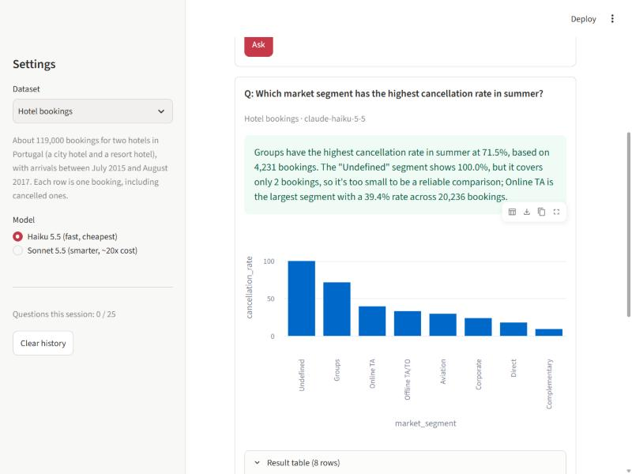

# 🔎 Ask Your Warehouse

Ask questions about a database in plain English. Claude writes the SQL, a safety check makes sure it only **reads** data, DuckDB runs it, and you get a plain-English answer, a chart, the result table, and the exact SQL that was used.



**Accuracy:** 40/40 test questions correct with Claude Haiku 5.5 (20 on hotel bookings, 20 on TPC-H). See [evals/last_run.md](evals/last_run.md).
**Cost:** about $0.0004 per question with Haiku.

## How it works

```
Your question
   ↓
Schema description ── tables, columns, types, example values, notes   (src/schema.py)
   ↓
Claude writes SQL ─── structured output: SQL + suggested chart         (src/sql_agent.py)
   ↓
Safety check ──────── one SELECT only, known tables only, no file/web   (src/guard.py)
   ↓                   functions; DB opened read-only, external access off
DuckDB runs it ─────── on error → error goes back to Claude to fix (max 2 retries)
   ↓
Claude explains the result in 1-3 sentences                             (src/sql_agent.py)
   ↓
Web page: answer + chart + table + SQL                                  (app.py)
```

Safety has two independent layers, so a query that somehow slipped past the SQL check still couldn't change data or read files:
1. **`check_sql`** parses the query with `sqlglot` and rejects anything that isn't a single read-only query on the dataset's own tables.
2. **`open_readonly`** opens DuckDB with `read_only=True` and `enable_external_access=False`.

## Datasets

| Dataset | Source | Size |
|---|---|---|
| **Hotel bookings** | [Hotel booking demand](https://doi.org/10.1016/j.dib.2018.11.126) (Antonio, Almeida & Nunes, 2019), via [TidyTuesday](https://github.com/rfordatascience/tidytuesday/tree/master/data/2020/2020-02-11) | 119,390 bookings, 2015–2017 |
| **TPC-H** | Generated locally by DuckDB's `tpch` extension (scale factor 0.1) | 8 tables, ~600k line items |

Both are built automatically into `data/` (git-ignored) on first run.

## Project layout

```
ask-your-warehouse/
├── app.py               # Streamlit web page
├── cli.py               # ask from the terminal
├── requirements.txt
├── src/
│   ├── data.py          # downloads / generates the datasets
│   ├── schema.py        # describes the tables for Claude
│   ├── guard.py         # read-only safety checks
│   └── sql_agent.py     # question → SQL → run → fix → answer
├── evals/
│   ├── questions.yaml   # 40 test questions + hand-written correct SQL
│   ├── run_evals.py     # runs them and scores the results
│   └── last_run.md      # latest score
└── docs/screenshot.jpg
```

Every file has line-by-line comments, and notes saying which other file each piece comes from.

## Run it locally

Needs Python 3.10+ and an Anthropic API key.

1. Put your key in the repo-root `.env` file (`C:\Study\data_ai\.env`, git-ignored):
   ```
   ANTHROPIC_API_KEY=sk-ant-...
   ```
2. From this folder, create the environment and install the libraries:
   ```powershell
   python -m venv .venv
   .venv\Scripts\Activate.ps1
   pip install -r requirements.txt
   ```
3. Start the web page (the first run builds the datasets, which takes about 30 seconds):
   ```powershell
   streamlit run app.py
   ```
   Then open http://localhost:8501.

Other commands:
```powershell
python -m src.data                                      # (re)build the datasets
python cli.py "Which hotel has the higher cancellation rate?"
python cli.py --dataset tpch --model sonnet "Total revenue by region"
python -m evals.run_evals                               # accuracy test (~2 cents with Haiku)
```

## How accuracy is measured

Each test question has a hand-written correct SQL query. The checker runs both and compares the **result values**, not the SQL text, so different but equivalent queries still pass. Column names don't need to match, numbers may differ by up to 1% (rounding), and for ordered questions ("top 5", "by year") the row order must match.

The test questions are phrased clearly. Vaguer questions ("which hotel is better?") are harder, and the app may interpret them differently from you, which is why it always shows the SQL it ran.

## Settings

| Setting | Where | Default |
|---|---|---|
| Model | sidebar (Haiku 5.5 / Sonnet 5.5) | Haiku 5.5 |
| Questions per visitor session | `MAX_QUESTIONS_PER_SESSION` env var | 25 |
| Max rows fetched | `MAX_ROWS` in `src/sql_agent.py` | 1,000 |
| Self-correction retries | `MAX_RETRIES` in `src/sql_agent.py` | 2 |
